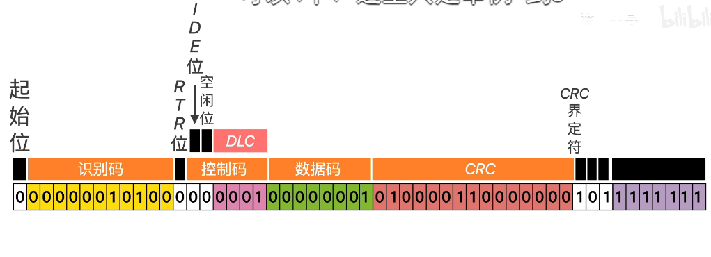

## 0. 前置

这是一帧标准的can帧，而我们需要编辑的就是其中的识别码(也叫canid)，和数据码。
其中canid长度为11位，数据码长度为8字节（即64位）。

## 1. ai的readme的重点章节
- 3.CAN ID 结构。这个讲canid由两大部分组成：node+cmd。node是电机的can节点，长度为6位；cmd是命令码，长度为5位
- 5.完整命令表。它讲解了每个命令的数据域的组成。